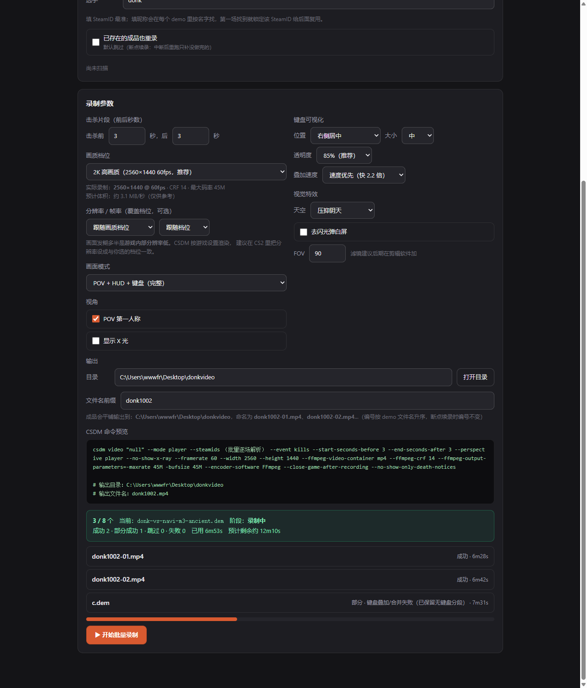

# cs2cut

**把 CS2 职业选手的天梯 demo，自动剪成带键盘可视化的 POV 击杀集锦。**

从 FACEIT 抓顶尖选手的比赛记录 → 筛出多杀（3K/4K/5K）场次 → 下载 demo →
CS Demo Manager 自动录制 → 叠上 WASD / 鼠标 / 蹲跳的按键可视化 → 输出一个能直接拖进剪辑软件的 mp4。

> 产出是**素材**，不是数据报表。




---

## 目录

- [它解决什么问题](#它解决什么问题)
- [两条子链路](#两条子链路)
- [前置依赖](#前置依赖)
- [安装](#安装)
- [用法一：录制链路（主功能）](#用法一录制链路主功能)
- [用法二：数据采集链路](#用法二数据采集链路)
- [画质档位](#画质档位)
- [项目结构](#项目结构)
- [两条反直觉的核心结论](#两条反直觉的核心结论)
- [常见问题](#常见问题)
- [合规与免责](#合规与免责)
- [License](#license)

---

## 它解决什么问题

想做一个「某选手在某张图的一波四杀」的剪辑素材，通常要：

1. 找到那场比赛、确认他真的拿了四杀
2. 下载 demo（几百 MB）
3. 用 CS2 回放，手动挑时间点、录屏
4. 手动把键盘操作画上去（或者干脆放弃）

这套流程一次要花几十分钟，而且**没法批量**。

本项目的目标是把上面 4 步压成一条命令 / 几次点击，并且**支持一次录一整个文件夹的 demo**。

---

## 两条子链路

两条链路互不依赖，可以只用其中一条。

| 子链路 | 作用 | 输出 |
|---|---|---|
| **录制链路**（主战场） | demo → 带键盘可视化的 POV 击杀集锦 | `.mp4` 视频 |
| **数据采集链路** | 批量抓选手多杀数据 | HTML 看板 / 排行榜 / CSV |

---

## 前置依赖

**只支持 Windows** —— CS2、CS Demo Manager、HLAE 都只有 Windows 版。

| 组件 | 必需性 | 说明 |
|---|---|---|
| **Python 3.10+** | 必需 | 录制链路 + 采集链路都要 |
| **CS2** | 录制必需 | 录制时要真的启动游戏 |
| **[CS Demo Manager](https://cs-demo-manager.com/)** | 录制必需 | 提供 `csdm` CLI，负责真正调 HLAE 录制 |
| **HLAE** | 录制必需 | 由 CSDM 一键安装，不用单独下 |
| **PostgreSQL 14+** | 必需 | CSDM 的 `analyze` 依赖它。Windows 服务必须处于运行状态 |
| **FFmpeg** | 必需 | 叠加 + 合并用。脚本会自动探测；也可把 `ffmpeg.exe` 放进 PATH |

> **FFmpeg 探测顺序**：环境变量 `CS2CUT_FFMPEG` → 项目内 `tools/ffmpeg*/bin` → `E:\ffmpeg`、`C:\ffmpeg\bin`、`C:\Program Files\ffmpeg\bin` → PATH。

> **PostgreSQL 探测顺序**：环境变量 `CS2CUT_PG_BIN` → `E:\pgsql18\pgsql\bin` → `C:\Program Files\PostgreSQL\{18,17}\bin`。

---

## 安装

```powershell
git clone https://github.com/YukinoKaorisuna/cs2cut.git
cd cs2cut

# 建议用虚拟环境，避免污染全局
python -m venv .venv
.\.venv\Scripts\activate

pip install -r requirements.txt
```

装完确认一下环境：

```powershell
python tools\check_dropframes.py --help   # 能跑起来说明 ffmpeg 找到了
```

如果 CSDM 不在默认位置（`%LOCALAPPDATA%\Programs\cs-demo-manager`），
把它的 `csdm.cmd` 所在目录加进 PATH，或告诉我具体路径。

---

## 用法一：录制链路（主功能）

### 启动工作台

```powershell
python recorder\app.py
```

浏览器会自动打开 `http://127.0.0.1:5000/`。
也可以双击 `recorder\启动工作台.bat`。

> **必须用真浏览器打开**。别用什么内置预览面板 —— 它连不上 localhost 后端，
> 会卡在「检测 CSDM…」、demo 目录一片空白。

### 单个 demo 录制

三步向导：**选 demo → 选选手 → 配参数 → 开始录制**。

后端跑 5 步，进度实时回传：

```
[1/5] 分析 demo 进数据库        csdm analyze --source valve
[2/5] 生成按键数据              demoparser2 解析 → 60fps 按键 JSON
[3/5] 自检 CS2 插件             CS2 更新会清掉插件，这里自动重装
[4/5] 录制 POV 击杀集锦         CSDM + HLAE（启动游戏，需几分钟）
[5/5] 叠加键盘可视化 + 合并      逐段叠 overlay → concat 出成品
```

**实测基准**（`lynn-vision-vs-nexvoid-m2-nuke`，17 段）：
2560×1440 / 60fps / 6980 帧 / 116.36 秒 / 373 MB。

### 批量录制

顶部切到「批量录制」。填三样东西就能跑：

| 字段 | 说明 |
|---|---|
| demo 目录 | 里面所有 `.dem` 都会被录 |
| 选手 | 昵称或 SteamID，**只需一位** |
| 文件名前缀 | 例如 `donk1002` → 产出 `donk1002-01.mp4`、`-02.mp4`… |

点「扫描」能看到编号预览。然后「▶ 开始批量录制」。

几个值得知道的行为：

- **串行执行**。同一时间只有一个 CS2 实例，一个 demo 几分钟，中途别关窗口。
- **编号按 demo 文件名升序**，和你往目录里丢文件的顺序无关。
- **断点续录**。成品已存在的自动跳过，编号不会漂移 —— 断了再开就是接着跑。
- 昵称模式下，第一场解析到的 SteamID 会被**锁定**给后续所有 demo 复用（防同名假号）。
- 每场之间会等 `cs2.exe` 完全退出。不退干净就开下一场，HLAE 挂钩会失败。

### 参数说明

| 参数 | 作用 |
|---|---|
| 击杀前 / 后 秒数 | 每个击杀片段的前后留白 |
| 画面模式 | `full`/`hud` 保留完整 HUD（血量弹药）；`pure`/`keys` 只留击杀提示 |
| POV 视角 | 是否锁第一人称视角 |
| 透视轮廓（X-ray） | 是否显示队友/敌人轮廓 |
| 键盘位置 / 大小 / 不透明度 | 叠加层的位置和存在感 |
| 天空 / 去除闪光 / FOV | 视觉微调（进 demo 后执行的 cfg） |
| 输出目录 / 文件名 | 都可自定义，空着就用默认值 |

**所有参数都会被记住**（落在 `recorder/prefs.json`），下次打开自动还原。

---

## 用法二：数据采集链路

```powershell
# 批量采集（可续跑，只补缺失的部分）
python src\batch_collect.py

# 生成看板
python src\dashboard.py

# 各类榜单
python src\multikill_ranking.py    # 多杀双榜
python src\multikill_report.py     # 逐场清单
python src\export_multikills.py    # 导出 CSV
```

产物在 `output/`：`dashboard.html` / `multikill_ranking.html` / `multikills.html` / CSV。

**耗时基准**：约 8–14 分钟/人（300 场）。按 `人数 × 10 分钟` 估。

选手名单在 `config.json`，改 `players` 数组即可：

```json
{
  "players": [
    { "nickname": "donk666", "expect_elo": 4500, "real_name": "donk" },
    { "nickname": "ZywOo",   "expect_elo": 3000, "real_name": "ZywOo" }
  ]
}
```

`expect_elo` 用来校验是不是本人 —— FACEIT 上同名假号很多，靠 Elo 区间兜底。

---

## 画质档位

默认 `2k-high`。每个档位绑定「分辨率 + fps + CRF + 最大码率」，
避免只调分辨率不调码率导致画面被压糊。

| 档位 | 分辨率 | fps | CRF | maxrate |
|---|---|---|---|---|
| `4k-high` | 3840×2160 | 60 | 14 | 80M |
| `4k` | 3840×2160 | 60 | 18 | 50M |
| **`2k-high`（默认）** | **2560×1440** | **60** | **14** | **45M** |
| `2k` | 2560×1440 | 60 | 18 | 28M |
| `2k-30` | 2560×1440 | 30 | 16 | 22M |
| `1080p-high` | 1920×1080 | 60 | 14 | 25M |
| `1080p` | 1920×1080 | 60 | 18 | 15M |
| `preview` | 1280×720 | 30 | 23 | 6M |

另有「叠加编码速度」下拉：速度优先（`veryfast`，快 2.2 倍）/ 均衡 / 体积优先（`medium`，小约 46MB）。

---

## 项目结构

```
cs2cut/
├── recorder/                  # ★ 工作台（GUI + 后端）
│   ├── 启动工作台.bat          #   双击启动
│   ├── app.py                 #   Flask 后端：5 步流程 / 档位 / 插件自检 / 批量
│   ├── prefs.example.json     #   偏好记忆的字段示例
│   └── static/index.html      #   单页前端：向导 + 参数 + 进度
│
├── src/                       # 核心逻辑
│   ├── killviz_compose.py     # 键盘 overlay 叠加 + 合并（性能核心）
│   ├── input_extractor.py     # demo → 60fps 按键 JSON
│   ├── keyviz_video.py        # 按键帧渲染（键盘布局定义）
│   ├── keyviz_overlay.py      # 按键悬浮窗（Tkinter，实验性）
│   ├── csdm_plugin.py         # CS2 插件自检 / 一键重装
│   ├── demo_parser.py         # demo 解析：多杀回合提取
│   ├── faceit_client.py       # FACEIT 内部接口封装（免 Key）
│   ├── faceit_api.py          # FACEIT 官方 Data API 封装（备用）
│   ├── demo_downloader.py     # demo 下载
│   ├── batch_collect.py       # 可续跑批量采集
│   ├── collector.py           # 主采集流程
│   ├── dashboard.py           # HTML 看板
│   ├── multikill_ranking.py   # 多杀双榜
│   ├── multikill_report.py    # 逐场清单
│   ├── export_multikills.py   # 导出 CSV
│   ├── backfill_multikills.py # 多杀字段回填
│   ├── multikills.py          # 单选手多杀抽取
│   ├── fetch_demos.py         # demo 批量下载
│   ├── fetch_one_demo.py      # 单场 demo 下载
│   ├── parse_demos.py         # 批量解析 demos/
│   └── verify_*.py            # 按键字段验证脚本
│
├── tools/                     # 通用脚本（其余调试探针不入库）
│   ├── check_dropframes.py    # 检查录制有没有丢帧
│   ├── decompress_demo.py     # 解压 .dem.zst
│   └── e2e_*.py               # 回归测试
│
├── docs/                      # 使用手册 + FACEIT 链路调研笔记
├── config.json                # 选手名单与采集参数
├── requirements.txt
└── LICENSE
```

运行时才会出现的目录（已在 `.gitignore`）：`output/`（产物）、`demos/`（原始 demo）、
`logs/`、`data/`（抓取数据）、`recorder/prefs.json`（本机偏好）。

---

## 两条反直觉的核心结论

这两条推翻了项目早期的设计假设，也是整套东西能跑通的关键。

### 1. FACEIT 抓取不需要 API Key

官方 Data API 要 2FA + 第三方审核（约 30 天），但**网页前端调用的内部接口完全公开、不需要认证**，
只要带 UA 和 Referer：

```text
GET https://www.faceit.com/api/users/v1/nicknames/{nickname}          # 昵称 → 玩家档案
GET https://www.faceit.com/api/stats/v1/stats/time/users/{pid}/games/cs2   # 比赛历史
GET https://www.faceit.com/api/match/v2/match/{match_id}              # demoURL 在 payload 下
GET https://www.faceit.com/api/stats/v1/stats/matches/{match_id}      # ★ 多杀数据在这里
```

`config.json` 里**没有也不需要** `faceit_api_key`。

另外：历史接口的 `offset` 有**硬上限 300 场**（跟每页多大无关），再往前取不到。

### 2. 3K / 4K / 5K 不需要解析 demo

match stats 接口的 `arr[0].teams[*].players[*]` 里直接给：

- **`i14` = 3K　`i15` = 4K　`i16` = 5K**
- 同一接口 `i6/i7/i8/i9` = 击杀 / 助攻 / 死亡 / MVP

> ⚠️ **字段名一名两义**：**历史接口的 `i14` 是结果码**，stats 接口的 `i14` 才是 3K。
> 混用两套字段表会得出完全错误的结论。

**粒度边界**：接口只告诉你「整场拿了几次多杀」，**不给「第几回合拿的」**。
回合级信息才需要解析 demo。

---

## 常见问题

**录制报 `Game error`**

两个根因：

1. 上次 CS2 没退干净 → `taskkill /F /IM cs2.exe`
2. **CS2 大更新会重置 `gameinfo.gi` 并删掉 CSDM 插件** → 工作台会显示橙色警示条，
   点「🔧 一键修复插件」，或者直接跑录制（第 3 步会自动重装）

**显示录制成功，但没有视频**

CSDM **失败时也返回退出码 0**。所以不能靠退出码判断。

后端用「录制前后目录快照对比」兜底，会明确报出「命令返回成功但没生成任何文件」，
并列出可能原因：该选手本场没击杀 / demo 未入库 / Steam 未登录 / HLAE 未配置。

**改了代码但页面还是旧的**

旧进程占着 5000 端口时，页面会继续由**旧代码**服务，改半天不生效。

```powershell
netstat -ano | findstr :5000
taskkill /F /PID <pid>
```

也可以看页面右上角的版本号徽章确认跑的是哪个版本。

**能用 GPU 加速吗**

不需要。合并环节用 `-c copy` 零重编码后只要 6 秒（原重编码 366 秒），
比任何 GPU 方案都快。而 `h264_nvenc` 对驱动版本要求还很高。

**录制时画面卡顿会不会丢帧**

不会。CSDM/HLAE 按 tick 精确重放。实测 22 段里 17 段零偏差，整体 -0.04%。
用 `python tools\check_dropframes.py` 可以自己验。

**键盘可视化为什么不是纯 `--concatenate-sequences`**

CSDM 合并后产物统一叫 `output.mp4`，文件名里的 `tick-A-to-B` 区间就没了，
而键盘 overlay 正是靠这个区间把按键数据对齐到画面上的 ——
所以本项目刻意让 CSDM **保持分段输出**，由后端逐段叠键盘、再自己 concat。

---

## 合规与免责

- **HLAE 录制会注入游戏进程**。必须用 `-insecure` 启动；录制前
  **关闭 FACEIT AC 等一切反作弊**；录制期间**绝不手动连官方/竞技服**。
  CSDM 纯分析 `.dem` 文件、不注入，零风险；只有 HLAE 那一步涉及注入。
- FACEIT 内部接口没有官方文档，随时可能变更，代码已做容错但无法保证长期有效。
- 本工具仅用于**个人学习研究与视频创作**。请勿大规模抓取、不要公开传播抓到的原始数据、
  不要把录制产物用于商业用途而不注明素材来源。
- 使用本工具产生的任何后果由使用者自行承担。

---

## License

[MIT](LICENSE) © 2026 YukinoKaorisuna
